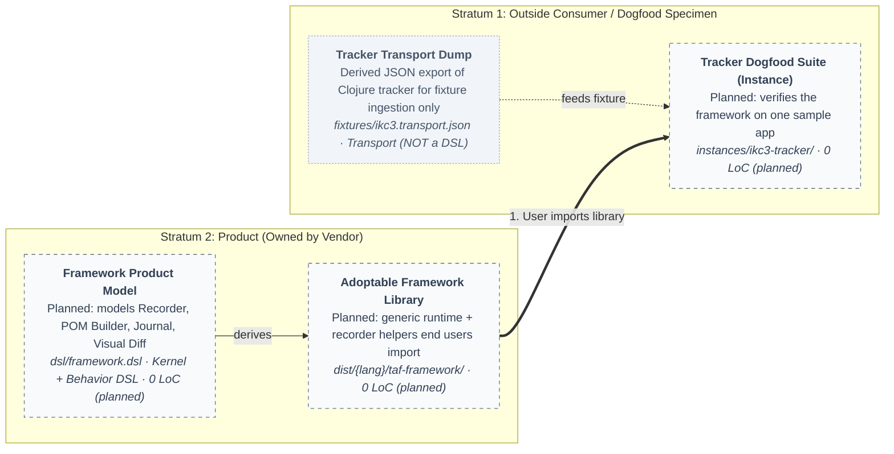
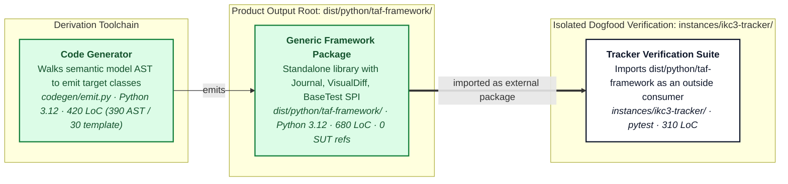

# DSL-First Development — Checkpoints & Architecture Floorplan Guide

> **A concise companion to the Methodology Guide: four review stops where the AI assistant draws an evolving visual floorplan of the system, reports measured technical telemetry (tools, languages, LoC by stratum), and answers a self-reflection check so subpar LLM shortcuts are caught at the stage they happen.**

**Version**: 1.0  
**Who reads this document**: both the **methodology user** (to review progress in 60 seconds at each stop) and the **AI coding assistant** (which produces the checkpoint report).  
**Prerequisites**: **none.** This guide adds no new DSL grammar and no build dependencies. Its visual mapping and "say what it does today" discipline are adapted from [Floorplan](https://github.com/haydenschmitty/floorplan).  
**Companions**: [Methodology Guide](DSL_FIRST_METHODOLOGY_GUIDE.md) · [Gates Guide](DSL_FIRST_GATES_GUIDE.md) · [Target Profile DSL](TARGET_DSL.md)

> **Origin**: Part of the [DSL-First Methodology](https://github.com/everapp-org/dsl-first) open-source project.  
> **License**: Apache 2.0 — see [LICENSE](../LICENSE)

---

## TL;DR — how to use this guide

An AI assistant can fail quietly at any stage: it can model an easy test example instead of the product you asked for, write a shallow list of names in `.dsl` while hardcoding 2,000 lines of logic as string templates inside the generator, mistake a JSON export for the source-of-truth DSL, or clone a flawed layout across five languages and declare victory because parity tests pass.

To catch shortcuts **at the stage they happen**, require a **Checkpoint Report** at four natural stops. Each report fits on one screen and has three parts:
1. **Visual Architecture Floorplan (Mermaid)** — boxes grouped by stratum, plain-English *"what it does today"* labels, file paths + LoC, dashed outlines for `not-built` parts, and green highlights for recent changes.
2. **Technical Telemetry Table** — measured tools, languages, and Lines of Code (LoC) broken down by stratum (exposing hardcoded template strings vs. real AST generation).
3. **Self-Reflect & Red-Flag Card** — 4 honesty questions the assistant answers, paired with red flags for the reviewer.

| you want to | say to the assistant (in plain practitioner terms) |
|---|---|
| **turn an idea into a clear specification & visual blueprint first** | *"Interview me about the software I want to build so we can write a clear specification (PRD) before any code is written. Ask one question at a time, each with your recommended answer. Help me clarify what the finished product is, who will use it and how, what it manages and the rules it must follow, and keep the product itself separate from any sample or test applications we use to try it out. When everything is clear, write up the specification with a visual blueprint diagram of the planned architecture (following `DSL_FIRST_CHECKPOINTS_GUIDE.md`) and wait for my approval."* |
| **build the software with review checkpoints at each stage (Recommended)** | *"Build this software using the DSL-First methodology files in this project. Pause for my review at the 4 checkpoints in `DSL_FIRST_CHECKPOINTS_GUIDE.md`. At each checkpoint, show me: (1) a visual architecture diagram of what exists today vs. what is still planned, (2) a technical report of the tools, languages, and lines of code built so far, and (3) your self-reflection check on whether anything was skipped, hardcoded, or mixed up with test examples — and wait for my approval before moving on."* |
| **build in one pass (YOLO) with a full visual & technical report at the end** | *"Build this software using the DSL-First methodology files in one pass without stopping for intermediate reviews, and finish with the full checkpoint report from `DSL_FIRST_CHECKPOINTS_GUIDE.md`: the visual architecture diagram, the technical report of tools, languages, and lines of code, and the self-reflection check."* |
| **extend or add a new language/feature to an existing project** | *"Before writing or generating any code for this request, run the pre-flight checkpoint from `DSL_FIRST_CHECKPOINTS_GUIDE.md` (Stop 4): show me on the visual architecture diagram which part of the product or test suite this request changes, what deliverable files will be produced, a technical report of the current tools, languages, and lines of code, and flag any shortcuts or mismatches in the existing code before copying them."* |
| **audit an existing repo or an in-progress AI session right now** | *"Read `DSL_FIRST_CHECKPOINTS_GUIDE.md` and inspect this repository. Show me a visual architecture diagram of what each part actually does today, a technical report of the tools, languages, and lines of code, and a self-reflection audit flagging any hardcoded shortcuts, unfinished parts, or test examples mixed into the product."* |

---

## 1. Four Boundary Terms (So Levels Never Collide)

Before the first diagram is drawn, every box and file in a DSL-First project belongs to one of four **strata** (levels). When a project builds a reusable tool or framework (a *meta-product* whose users also model their own domain), keeping these four distinct prevents 90% of architectural drift:

| Stratum | Plain Name | What it is | Who owns it | What it produces |
|---|---|---|---|---|
| **S3 (`M2`)** | **Methodology Language** | The grammars/schemas (`KERNEL_DSL`, `BEHAVIOR_DSL`, `VERIFICATION_DSL`, `CATALOG_DSL`, `TARGET_DSL`). | Methodology | Parser / schema validator |
| **S2 (`M1-product`)** | **Product Model** | The model of the **product or framework itself** (its capabilities, lifecycles, runtime contracts). | **Vendor / Product Team** | **The Product** (e.g., an adoptable library, runtime, or CLI tool) |
| **S1 (`M1-instance`)** | **User / Specimen Model** | A model of a **specific application or System Under Test (SUT)** built *using* the product. | **End User** (or a quarantined dogfood test fixture) | **An Instance** (e.g., one application's test suite `taf-impl-<sut>`) |
| **S0 (`transport`)** | **Transport Artifact** | A derived export (`EDN → JSON`, schema dump) created only so tool A can read tool B's data. | **Build Script (Derived)** | In-memory ingestion only (**never** cited as "the DSL" or SSOT) |

> **Single-app simplification:** If you are building one ordinary application (not a reusable framework/tool), **S2** and **S1** merge into a single **Application Domain Model**. You still keep **Transport Artifacts (S0)** and **Test Fixtures** separate from the application deliverable.

---

## 2. Visual Floorplan Conventions (Adapted from Floorplan)

Every checkpoint includes a Mermaid `flowchart` that acts as a live architectural floorplan of the project at that phase. The assistant must follow five rules adapted from [haydenschmitty/floorplan](https://github.com/haydenschmitty/floorplan):

1. **Group by Stratum & Boundary, not by folder tree.** Draw subgraphs for:
   - `Models (SSOT)` (separating *Product Model* from *Specimen/User Model* and *Transport Files*)
   - `Derivation Toolchain` (Parser/Schema + Generator/Interpreter)
   - `Product Deliverable` (what the outside user actually installs/adopts)
   - `Dogfood Instance & Tests` (kept visually outside the Product Deliverable box)
2. **Three lines per card: Plain Name + "What it does today" + Technical Footer.**
   - **Line 1:** Short plain-English name (`2–5 words`).
   - **Line 2 ("Say what it does today"):** One honest present-tense sentence describing what the artifact *actually does right now*—never what its filename promises. If a model file only lists enum words and no behavior, say: *"Lists 13 env var names only; behavior not modeled yet."*
   - **Line 3:** `path · language/tool · LoC (or item count)`.
3. **Visual Status Styling (Blueprint → Built → Changed → Warning):**
   - **Dashed border (`planned`)** — Planned in spec or declared `status not-built`, not implemented yet.
   - **Solid border (`built`)** — Implemented and derived from the model.
   - **Green fill (`changed`)** — Newly added or modified in the current phase (*Recent work*).
   - **Amber/Red border (` hotspot`)** — Health warning: oversized hardcoded string template in a generator, unmapped file, or specimen code leaking into the product root.
4. **Trace the Primary User Flow.** Number the edges (`1`, `2`, `3`) showing how the **end user** interacts with the deliverable from the outside.
5. **Pin Open Questions & Assumptions to Cards.** In early phases, attach open decisions directly to the card they affect.

**Standard Mermaid Styles (copy into every checkpoint diagram):**
```mermaid
flowchart LR
    classDef planned stroke-dasharray: 5 5,fill:#f8fafc,stroke:#64748b,color:#334155
    classDef built fill:#ffffff,stroke:#0f172a,stroke-width:2px,color:#0f172a
    classDef changed fill:#dcfce7,stroke:#15803d,stroke-width:2px,color:#14532d
    classDef hotspot fill:#fef3c7,stroke:#d97706,stroke-width:2px,color:#78350f
    classDef transport fill:#f1f5f9,stroke:#94a3b8,stroke-dasharray: 2 2,color:#475569
```

---

## 3. Technical Telemetry & Health Report (Required at Every Stop)

The assistant must **measure** (via shell/file inspection, never guessing) and print this compact telemetry block at every checkpoint:

### 3.1 Stack & Tools Inventory
| Role | Tool / Language & Version | Purpose in this project |
|---|---|---|
| **DSL Languages Used** | e.g., `KERNEL_DSL v1.2`, `BEHAVIOR_DSL v1.0`, `TARGET_DSL v0.1` | Which modeling concerns are active |
| **Carrier & Validator** | e.g., Text + ANTLR 4.13 / EDN + Malli / TOML + `tomllib` | Grammar-hosted or data-hosted front end |
| **Deriver / Emitter** | e.g., Python AST emitter / JavaPoet / Roslyn / Runtime interpreter | How models become executable artifacts |
| **Target Lane(s)** | e.g., `java "21"` + JUnit 5.11 + Playwright 1.49 + NullAway | Host compiler, test runner, driver, static gates |

### 3.2 Measured LoC & Artifact Breakdown by Stratum
| Stratum / Category | Files | Measured LoC | Composition & Honesty Metric |
|---|---|---|---|
| **S2: Product Model (SSOT)** | `N` | `LoC` | `X` entities/states, `Y` transitions, `Z` procedures, `W` `not-built` |
| **S1: Specimen / User Model** | `N` | `LoC` | Quarantined test-domain model (0 references inside S2) |
| **S0: Transport Artifacts** | `N` | `LoC` | Derived from `<upstream SSOT>` (not hand-edited) |
| **Toolchain / Generators** | `N` | `LoC` | **`A` LoC AST-driven logic vs. `B` LoC embedded literal code strings** |
| **Derived Product Output** | `N` | `LoC` | 100% generated; 0 specimen identifiers |
| **Hand-Written Substrate/Glue** | `N` | `LoC` | Pinned by `C` bidirectional conformance tests |
| **Derived Specimen Instance / Tests** | `N` | `LoC` | End-to-end verification using the packaged Product |

> **Why the Generator LoC split matters:** When a weak LLM pretends to use DSL-First, it writes a 40-line `.dsl` file of constant names and embeds 2,500 lines of literal Java/C#/Python code inside multiline strings in the generator script. Measuring **AST-driven LoC vs. literal template-string LoC** exposes that shortcut immediately.

---

## 4. The Four Checkpoint Stops

### Stop 1 — Scope & Blueprint Checkpoint *(After Phase 0/1, before writing any DSL)*

**Goal:** Lock in what the product is, how an outside user uses it, and where any test specimen or transport file sits—before a single `.dsl` file is written.

#### 1. Visual Blueprint Floorplan (Example: Meta-Product / Test Framework)


#### 2. Assistant Self-Reflection & User Acceptance Check
* **Assistant must answer:**
  1. **Product vs. Instance:** What is the deliverable product, and how is any dogfood test example kept separate from it?
  2. **Model Owners:** Who authors the Product Model vs. who authors/records the User Domain Model?
  3. **Transport Files:** Are there any serialized interop files (`EDN → JSON`), and are they marked as *Transport* rather than "the DSL"?
  4. **Outside User Flow:** In 3 steps, what does an end user do after installing our product?
* **User Red-Flag Checklist (Catching subpar LLM work at Stop 1):**
  - 🚩 **Specimen Capture:** The blueprint mixes nouns from your test example (`BoardPage`, `Tracker`) into the Product box.
  - 🚩 **Transport as SSOT:** An imported `.json` dump is labeled as the project's modeling language.
  - 🚩 **Missing User Entrypoint:** The user expects an interactive tool (e.g. a Recorder or library API) and it is absent from the Product box.

---

### Stop 2 — Model Substance Checkpoint *(After Phase 2/3, before generating code)*

**Goal:** Prove the model actually captures *behavior and structure*, not just a shallow list of names, and openly declares what is `not-built`.

#### 1. Visual Model Floorplan
The assistant updates the diagram: modeled capabilities turn **solid (`built`)** or **green (`changed`)** with actual line and construct counts; capabilities deferred to later remain **dashed (`planned` / `status not-built`)** with their reason visible on the card.

#### 2. Technical Telemetry Check
The table (§3.2) must report counts of **entities, states, transitions, procedures (`execution` blocks), verification checks, and `not-built` declarations**.

#### 3. Assistant Self-Reflection & User Acceptance Check
* **Assistant must answer:**
  1. **Behavior vs. Surface:** Which product capabilities have full state machines or step-by-step procedures modeled, and which only declare data/catalogs?
  2. **Honest Absences:** Which capabilities from Stop 1 are currently marked `status not-built reason "..."`?
  3. **Zero Specimen Leakage:** Do zero identifiers from the dogfood specimen appear in the Product Model?
* **User Red-Flag Checklist (Catching subpar LLM work at Stop 2):**
  - 🚩 **The Vocabulary-Only Fake:** The `.dsl` file has 0 state transitions and 0 procedures—only lists of env vars, filenames, or enum strings (meaning the LLM plans to hardcode all real logic in generator strings in Phase 4).
  - 🚩 **Modeling the Easy Thing:** The LLM wrote a rich model of the *test example* (`*.sut.model.json`) while leaving the *product model* thin or empty.
  - 🚩 **Silent Drop:** A feature from Stop 1 vanished instead of appearing as a dashed `not-built` card on the floorplan.

---

### Stop 3 — First-Lane Derivation & Surface Checkpoint *(After Phase 4/5 on Lane 1, BEFORE adding Lane 2+)*

**Goal:** Verify on **one target language** that the generator is honest (not pasting giant hardcoded string blobs) and that the top-level generated folder is the actual product an outside user adopts.

#### 1. Visual Build Floorplan (Highlighting Derivation Honesty & Output Root)


#### 2. Technical Telemetry Check
Must show the **Generator LoC Split** (`AST-driven LoC` vs. `Literal template-string LoC`), the **top-level directory tree** of the product output, and the test/gate pass counts.

#### 3. Assistant Self-Reflection & User Acceptance Check
* **Assistant must answer:**
  1. **Output Root Inspection:** When a reviewer opens the product output directory root, what files do they see first? Are there zero specimen files (`BoardPage`, `SutConfig`) in that tree?
  2. **Generator Honesty Ratio:** What percentage of the generator script is literal target-language string templates? (If >20% is unparameterized code strings, flag the card as an amber `hotspot`: either model that behavior or move it to `hand-written/` with a conformance test).
  3. **Standalone Consumer Proof:** Can an outside project import the Product Output directory and use it with zero files from the specimen directory?
* **User Red-Flag Checklist (Catching subpar LLM work at Stop 3):**
  - 🚩 **The String-Template Masquerade:** Generator telemetry shows hundreds or thousands of lines of literal Java/C#/Python strings embedded inside emitter scripts.
  - 🚩 **Instance at the Root:** The generated output root mixes dogfood specimen classes (`BoardPage.cs`, `Actions.cs`) with the product runtime (`taf-runtime/`).
  - 🚩 **Premature Multi-Lane Fan-Out:** The LLM starts building Lane 2, 3, or 4 before Stop 3 has been reviewed and approved on Lane 1.

---

### Stop 4 — Extension & Multi-Lane Checkpoint *(Phase 6: Before and after "extend / add language / generate" requests)*

**Goal:** Prevent blind lane-cloning and the *"parity tests are green so the deliverable must be right"* trap when extending an existing project.

#### 1. Pre-Flight Check (Before Writing Code) & Delta Floorplan (After)
Before acting on *"Extend X to language Y"* or *"Add feature Z"*, the assistant prints a 4-line Pre-Flight check and updates the Floorplan with green `changed` cards for what the request will touch:
1. **Target Stratum & Owner:** `S2 Product` vs. `S1 User Instance`.
2. **Deliverable Surface at Output Root:** Exact kind of artifact that will appear at the top level of the output directory.
3. **Prior-Lane Audit:** Do the existing lanes actually deliver that product shape, or do they have a structural flaw (amber `hotspot`) that must not be cloned?
4. **Surface Check + Fidelity Check:** How the output's *class of deliverable* will be verified alongside cross-lane parity.

#### 2. User Red-Flag Checklist (Catching subpar LLM work at Stop 4)
- 🚩 **Blind Parity Cloning:** The LLM immediately clones existing lanes into a new language without checking whether existing lanes emit a specimen instance instead of the product.
- 🚩 **Fidelity Without Surface Validation:** Citing "100% byte-parity across lanes" or "generated code cannot drift" as proof that the right product was delivered.
- 🚩 **N× Hand-Porting:** Adding a new language lane requires writing 500+ lines of raw target-language code strings inside the new emitter instead of mapping `TARGET_DSL` constructs over the shared semantic model.

---

## 5. One-Page Copy-Paste Checkpoint Template (For the Assistant)

When reporting at Stops 1–4, the assistant uses this exact structure:

```markdown
## Checkpoint Report — Stop <1|2|3|4>: <Phase Name>

### 1. Visual Architecture Floorplan ("What It Does Today")
```mermaid
flowchart LR
    %% Grouped by Stratum (S2 Product vs S1 Instance vs S0 Transport)
    %% Dashed = planned/not-built | Solid = built | Green = changed this step | Amber = hotspot
```

### 2. Technical Telemetry (Measured)
- **Tools & Stack:** <DSL languages, parser/schema, generator/interpreter, target language + runner + static checks>
- **LoC & Stratum Breakdown:**
  | Stratum / Layer | Files | LoC | Notes / Honesty Metric |
  |---|---|---|---|
  | S2 Product Model (SSOT) | ... | ... | ... transitions, ... procedures, ... `not-built` |
  | S1 Specimen / Instance Model | ... | ... | Quarantined from S2 |
  | S0 Transport Artifacts | ... | ... | Derived from ... |
  | Generator / Toolchain | ... | ... | ... LoC AST logic vs. ... LoC literal string templates |
  | Derived Product Output | ... | ... | Root path: `...` (0 specimen refs) |
  | Hand-Written / Conformed | ... | ... | Pinned by ... conformance tests |

### 3. Self-Reflection & Health Audit
1. **Product vs. Specimen Boundary:** ...
2. **What It Does Today vs. What Is `not-built`:** ...
3. **Derivation Honesty (No Template Masquerade):** ...
4. **Health / Red Flags Detected:** <None, or list any amber hotspots requiring user decision>
```

